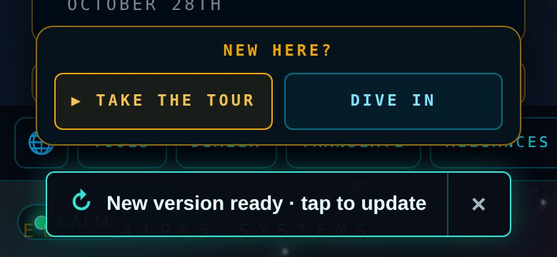
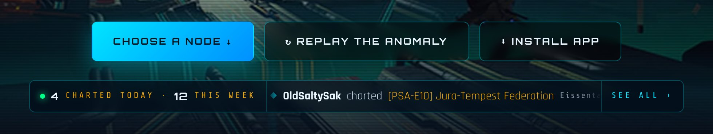
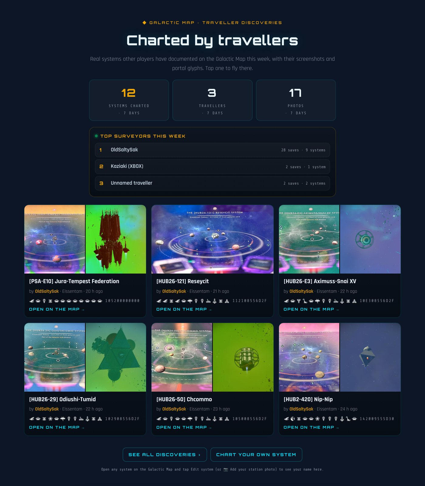
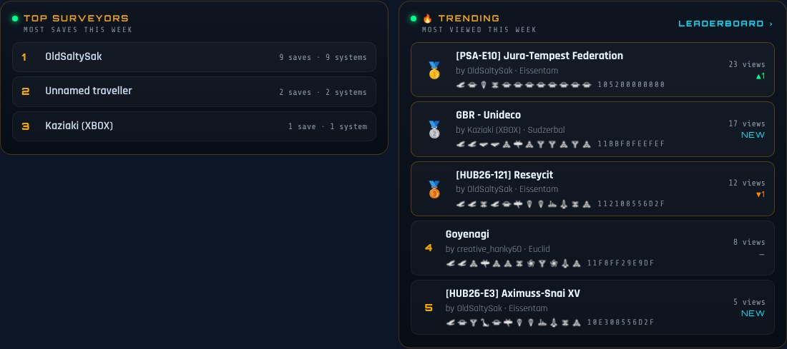
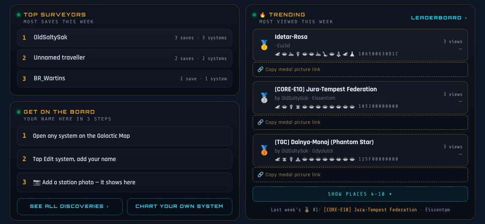
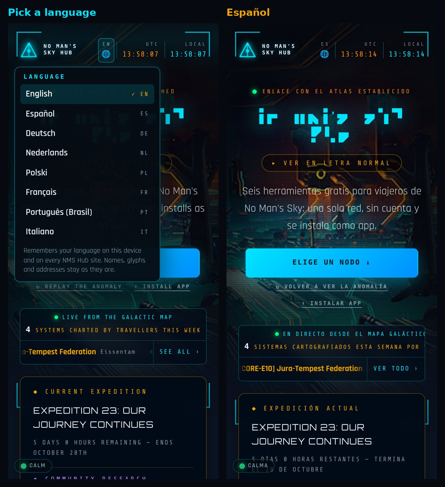
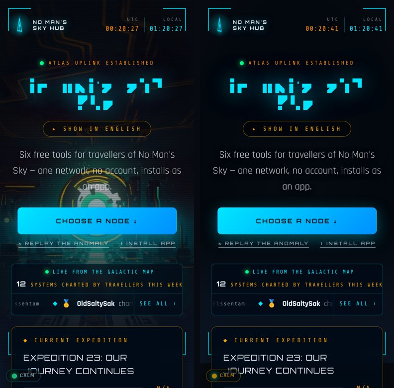
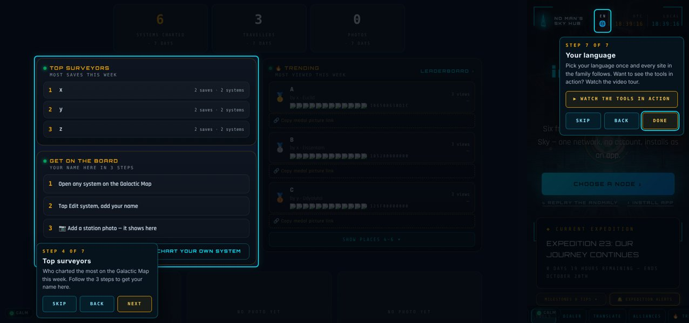
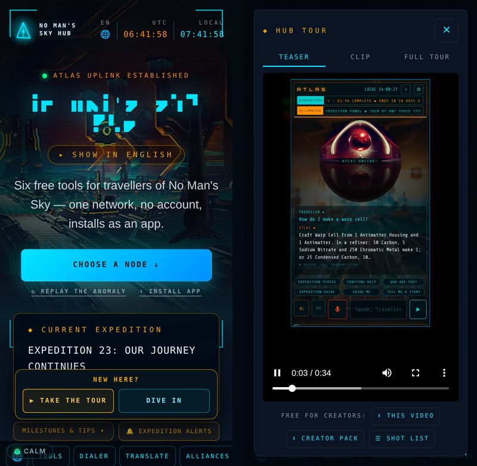

# No Man's Sky Hub

**Live:** [nomansskyhub.app](https://nomansskyhub.app)

The front door to a family of free, fan-made *No Man's Sky* tools. One cinematic page that links every tool, dials portal addresses, and tracks the live expedition. No account, no ads, and it installs as an app.

 <b><a href="https://nomansskyhub.app/assets/nms-hub-tour.mp4">▶ Watch the full 2-minute tour</a></b> · <a href="https://nomansskyhub.app/assets/nms-hub-teaser-30s.mp4">34 s teaser</a> · <a href="https://nomansskyhub.app/assets/nms-hub-creator-pack.zip">creator pack</a> (free to use, original music)

**Contents** — long sections are folded; tap to open.

- [What it does](#what-it-does)
- [Take a tour](#take-a-tour)
- [The family](#the-family)
- [How it's built](#how-its-built)
- [Videos for creators](#videos-for-creators)
- [Credits](#credits)
- [Using this code?](#using-this-code)
- [Licence](#licence)

<!-- folded -->

## What it does

▸ Tap to open

- **Anomaly intro and cinematic hero** with a live clock and a status bar showing the current expedition (name and time left).
- **Community Research.** Inside the expedition card, a live strip shows the Space Anomaly's Community Research: the tier (e.g. *Tier 2 of 2*) and how far through it Travellers are, with a bar, exactly as on Hello Games' [Galactic Atlas](https://galacticatlas.nomanssky.com/poi/community-research) sidebar. As more universal data is submitted, the Quicksilver Synthesis Companion unlocks more collectables. Tap it to open the official page. It also appears in the top-bar ticker, rechecks every 10 minutes, and stays hidden if the Atlas isn't answering, so it never shows a wrong number.
- **Six nodes, one network.** Image cards for every tool in the family (see below).
- **Portal dialer.** Enter or tap a 12-glyph portal address, pick any of the 256 galaxies, and jump straight to that system on the Galactic Map. You can also type or paste the hex address straight into the **Hex code** box: each digit fills the next glyph.
- **Speak like the Atlas.** A built-in NMS alphabet translator.
- **Expedition milestones & tips.** Under the live expedition card, every milestone of the current expedition by phase — what to do, hints and rewards — read live from the No Man's Sky Wiki.
- **Traveller ID.** Save your name, platform, home galaxy and (optionally) your NMS friend code once. The sister sites read it from a small cookie on `.nomansskyhub.app` (nothing goes to a server): ATLAS greets you by name, the Galactic Map opens in your home galaxy on a first visit, the Weather planet card carries your name, and the Theme Pack's portal wallpaper fills in your name, galaxy and friend code. "Forget me" removes it.
- **Expedition alerts.** 🔔 EXPEDITION ALERTS under the expedition card turns on notifications when a new expedition starts and 24 hours before it ends, in your language, under the Hub's own name (`nms-push.js`; sent by the Weather station's alert server).
- **Galactic Alliances.** A short guide to alliances from the Cosmos update, with the details (founding one, joining one, the three-alliance limit, alliance teleporters and how the rankings work) behind a **How alliances work** button. A **live top 5** leaderboard (re-checked every 15 minutes while the page is open) (in-game rank, members, stations and 24-hour changes) sits above it, courtesy of [Voyager's Haven](https://havenmap.online) by [u/IAmThe-Ekimo-1920](https://www.reddit.com/user/IAmThe-Ekimo-1920/); the full top 10 runs on the ATLAS alliance ticker.
- **Recently charted ticker.** Under the hero buttons, a live strip headed *Live from the Galactic Map* says how many systems travellers charted there today and this week, then a slow tape of *name charted system · galaxy · time* links that fly straight to each system. It pauses on hover, keyboard focus or a finger press so a link is easy to tap, stands still for anyone who has reduced motion turned on, and **See all ›** opens the map's own Recently charted list. Read from the map's small `?recent=1` feed; only the names travellers chose to type are shown.
- **Traveller Discoveries.** Right under Galactic Alliances: what other players charted on the Galactic Map this week. Systems, travellers and photos this week, a **Top surveyors this week** board in the same style as the alliance top 5, and the six latest systems as photo cards with who charted them, the portal glyphs and hex address, and a link that flies straight there (a swipeable row on phones). **See all discoveries ›** opens the full public page at [map.nomansskyhub.app/community](https://map.nomansskyhub.app/community). Read from the map's small `?discoveries=1` feed; bulk imports are left out and the section hides itself if there's nothing to show.
- **Get on the board.** Under Top surveyors (filling the space beside the taller Trending board), a short box shows new travellers how to get their name on the Hub in 3 steps: open any system on the Galactic Map, tap Edit system and add your name, add a station photo. **See all discoveries ›** and **Chart your own system** sit in the same box, so nothing extra is added at the bottom of the section. On phones the steps are compact one-liners.
- **🔥 Trending this week.** Beside Top surveyors (people ranked by how much they charted), a **Trending** board ranks the *systems* travellers opened most on the Galactic Map this week: 🥇🥈🥉 medals, ▲/▼ arrows, view counts and the portal glyphs with the hex address, plus **Leaderboard ›** to the full top 10 on the map. Each row has a **🔗 Copy medal picture link** button: the link opens that system's medal picture on the map, for pasting anywhere a picture can't be attached (Reddit messages, for example). Top-three systems also get a **#1 Most viewed** badge on their photo card and a medal in the ticker tape, which also shows *🔥 #1 trending this week*. It resets every Monday at midnight (UK). Until the new week has three entries, it shows last week's final standings. To save scrolling, only 🥇🥈🥉 show at first; **Show places 4–10** opens the rest (the Hub remembers your choice). Read from the map's `trending` feed; private systems are never counted.
- **Share buttons.** The footer has **Share on X**, **Reddit** and **Discord**. Discord has no share link, so the Discord button copies a short message with the Hub link and opens Discord; you choose the server or DM and paste it (a note says it's copied). Same idea as Reddit, where you pick the community.
- **Calm mode.** A small **Calm** switch in the bottom-left corner swaps the patterned and image backgrounds for a plain dark one, for anyone who finds the page busy. It's shared across the whole No Man's Sky Hub family (one switch turns it on for every site) and lives in `calm.js`.
- **Your language.** The 🌐 button switches the page between English, Español, Deutsch, Nederlands, Polski, Français, Português (Brasil) and Italiano. It sits with the clocks in the top bar (and in the jump bar on phones). The choice is shared by the whole No Man's Sky Hub family: pick it once and every site follows (a small cookie on `.nomansskyhub.app`; when you pick a language, an anonymous count of which one is sent to the site's cookie-free GoatCounter stats, so we can see which languages people use). On a first visit the page offers your phone's language once instead of switching by itself. Names, glyphs and portal addresses stay as they are. It lives in `lang.js` (the same file on every site), with one small pack per language in `lang/` and a font for Polish letters in `fonts/`.
- **Always the newest version.** An installed app on a phone isn't reloaded when you switch back to it, so it could keep showing an old version until it was closed and reopened. Now, each time you come back to it (and every 30 minutes while it stays open), it checks for a new version. If one is live, a small bar says “New version ready · tap to update”, in your language. One tap reloads in place; × hides it. It never reloads by itself, so nothing you're in the middle of is lost. It lives in `nms-update.js`, the same file on every site.
- **⟳ Refresh.** In the installed app there's no browser reload button (and pull-to-refresh doesn't work everywhere), so a small ⟳ button sits next to the language button in the header. Tap it and it checks for a new version and reloads in place, on the same view. It only shows in the installed app. After a big batch of updates, the first open on that day says “✓ Updated · that's the last update today”, so nobody wonders if more pop-ups are coming. The opening picture now shows straight away instead of fading in, and the scan line across it no longer makes the page jump while it loads (faster first view on phones). The old nomansskyhub.netlify.app address now sends search engines here with a permanent (301) redirect.

  

- **Built for phones too.** On a phone the page is about 40% shorter: a sticky jump bar (Tools · Dialer · Translate · Alliances · 🔥 Trending · My ID), the six tool cards in one swipeable row, the dialer's explainer and saved addresses folded behind toggles, the translator opening its NMS-text panel when you tap in, the expedition card tucked into the hero, and a back-to-top button. Desktop is unchanged.
- **Short links.** `nomansskyhub.app/atlas`, `/weather`, `/theme`, `/translator` and `/map` jump to each tool.

**New on the Theme Pack: make it yours.** Put your Traveller name and home portal glyphs on a wallpaper, wear one of today's real player-charted planets from the Weather Station, or keep a live expedition countdown on your home screen: [theme.nomansskyhub.app](https://theme.nomansskyhub.app/#studio-portal).

## Take a tour

One gold **▶ TAKE A TOUR** button in the footer starts a 7-step tour of the page itself (the same spotlight tour as Atlas, Weather, Translator and Theme): the six tool cards, the portal dialer, the translator, Top surveyors + Get on the board, 🔥 Trending, My Traveller ID and the 🌐 language button. Skip, Back and Next on every step; Esc or the phone's Back button closes it. The last step has **▶ Watch the tools in action**, which opens the video pop-up with the teaser, the portal-dialer clip and the full tour (videos only load when tapped). Creator downloads (this video, creator pack, shot list) live inside it. First-time visitors are offered the tour once by a small **New here?** box after the intro. The tour lives in `nms-tour.js` (shared by every site).

There's also a **▶ TAKE A TOUR** button in the hero, beside Install App. The hero buttons are now all the same size and line up with the Live from the Galactic Map strip underneath. On phones they sit under the main button as small links.

**Back to top.** Once you scroll down, a teal ⇧ arrow appears in the bottom-right corner. Tap it to glide back to the top (instant with reduced motion). It's the same arrow on every No Man's Sky Hub site.

## The family

| Tool | Link |
|---|---|
| ATLAS — voice AI companion | [atlas.nomansskyhub.app](https://atlas.nomansskyhub.app) |
| Weather as a planet scan | [weather.nomansskyhub.app](https://weather.nomansskyhub.app) |
| Galactic Map and portal decoder | [map.nomansskyhub.app](https://map.nomansskyhub.app) |
| Theme Pack — icons, wallpapers, font | [theme.nomansskyhub.app](https://theme.nomansskyhub.app) |
| Alphabet Translator | [translator.nomansskyhub.app](https://translator.nomansskyhub.app) |

## How it's built

▸ Tap to open

Plain HTML, CSS and JavaScript with no build step and no framework. Deployed on Netlify straight from this repo: every push to `main` goes live.

| File | What it is |
|---|---|
| `index.html` | The whole page: layout, styles and logic |
| `research.js` | Community Research strip in the expedition card (Galactic Atlas mission feed) |
| `codex.js`, `expguide.js`, `expguide.css` | Expedition milestones & tips (NMS Wiki data; `codex.js` is shared with ATLAS) |
| `mobile.css`, `mobile.js` | Phone layout: jump bar, swipeable tool cards, dialer folds, back-to-top |
| `alliances.css`, `alliances.js` | The Galactic Alliances section, including the live top 5 |
| `ticker.js`, `ticker.css`, `discoveries.js`, `discoveries.css` | Recently charted ticker and Traveller Discoveries (Galactic Map feeds) |
| `trending.js`, `trending.css` | 🔥 Trending this week board, medals on cards and in the ticker |
| `calm.js` | Calm mode switch, shared by every site in the family |
| `lang.js`, `lang/`, `fonts/` | Language picker and translations, shared by every site in the family |
| `_redirects` | Short links, plus same-origin proxies for the Galactic Atlas API (`/nms-api/`) and the Voyager's Haven alliance leaderboard (`/haven-api/alliances`) |
| `sw.js` | Service worker for install and offline use |
| `manifest.webmanifest` | App install details |
| `assets/` | Backgrounds, intro video, glyph masks, icons and the NMS alphabet font |

## Videos for creators

All in the footer's TAKE A TOUR pop-up and free to use in videos (monetised ones included), reviews and posts. The music in the tour and teaser is original, made for them (no third-party tracks or samples), so they won't trigger copyright / Content ID claims. A credit to nomansskyhub.app is appreciated.

- `assets/nms-hub-tour.mp4`: 2-minute captioned tour of every tool, portrait 1080x1920, original music (FULL TOUR VIDEO)
- `assets/nms-hub-teaser-30s.mp4`: 34-second captioned teaser for Shorts, Reels and TikTok (30s TEASER)
- `assets/nms-hub-creator-pack.zip`: 19 clean 16:9 clips of every tool, 1920x1080, 5-10 seconds each, no text and no audio, with a README (CREATOR PACK)
- `assets/nms-hub-portal-dialer-clip.mp4`: 17-second clip of the portal dialer (CREATOR CLIP)
- `assets/nms-hub-tour-shotlist.txt`: timestamps for every scene in the tour (SHOT LIST)

## Credits

- Live Community Research data: the official Galactic Atlas API by Hello Games
- Expedition milestones: the [No Man's Sky Wiki](https://nomanssky.fandom.com) community (CC BY-SA)
- Real worlds and alliance leaderboard (in ATLAS and NMS Weather): [Voyager's Haven](https://havenmap.online), built and run by [u/IAmThe-Ekimo-1920](https://www.reddit.com/user/IAmThe-Ekimo-1920/)
- Real planet and system data (on the Galactic Map and the Translator): [NMS Almanac](https://nmsalmanac.com), built and run by Borjomi ([u/Fosferus](https://www.reddit.com/user/Fosferus/))
- NMS Alphabet font by seontonppa (built with FontStruct), used with permission

The footer's **Live data** line links all three sources (NMS Almanac, Voyager's Haven and the Galactic Atlas).

## Using this code?

It's free to use under the MIT licence. If you use any of it in your own project, site, video or post, please credit **elegra1965 / No Man's Sky Hub** with a link to [nomansskyhub.app](https://nomansskyhub.app). The MIT licence also asks you to keep the copyright notice in `LICENSE` with any copied code.

## Licence

The code is MIT licensed (see `LICENSE`). Game names, glyphs and imagery belong to Hello Games and are not covered by that licence.

*An unofficial, fan-made project. Not affiliated with, sponsored by, or endorsed by Hello Games.*

Built by elegra1965.
